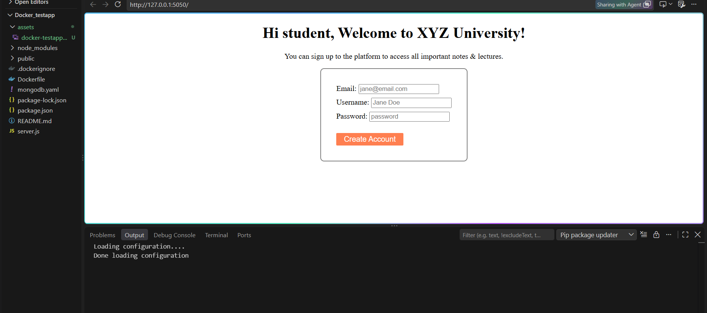
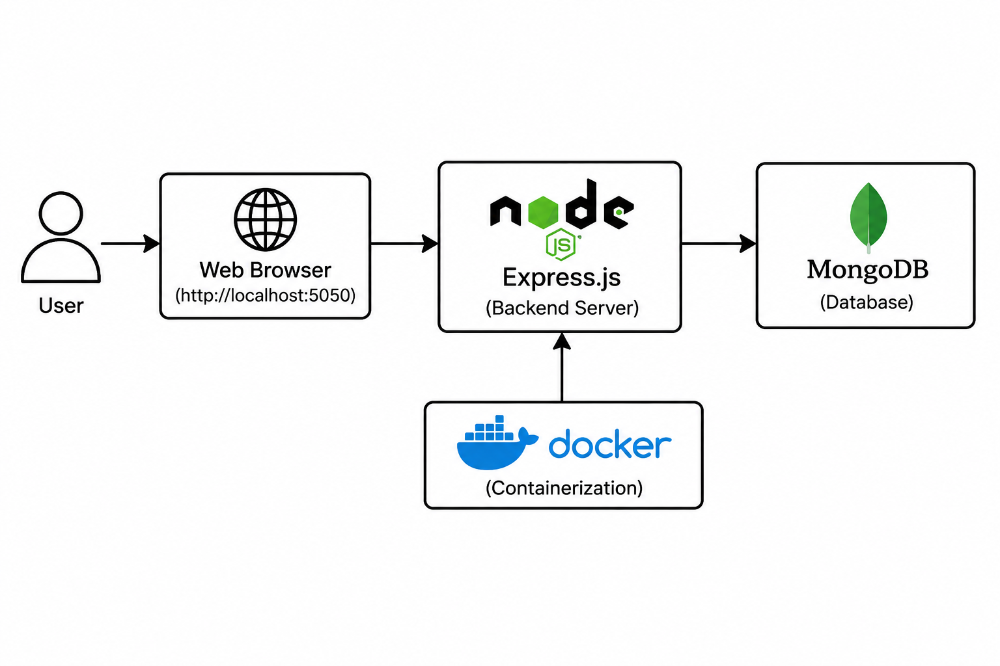

# Docker TestApp – University Student Registration Portal

A containerized web application developed using **Node.js, Express.js, MongoDB, Docker, and Docker Compose**. The application provides a student registration interface and demonstrates how a web application and database can be deployed using containerization.

## Project Overview

Docker TestApp is a web-based student registration application designed around a university portal. Students can enter their email address, username, and password through a simple registration interface.

The project demonstrates the integration of a Node.js backend with MongoDB and the use of Docker to create a consistent and portable application environment.

## Application Preview



## Docker Architecture



## Features

- **Student Registration:** Provides a registration interface for student details.
- **Backend Integration:** Uses Node.js and Express.js to handle application requests.
- **Database Integration:** Uses MongoDB for data storage.
- **Containerization:** Uses Docker to package the application and its dependencies.
- **Database Management:** Supports MongoDB container deployment.
- **Portable Environment:** Enables consistent execution across different environments.

## Technology Stack

| Technology | Purpose |
|---|---|
| HTML | Frontend structure |
| CSS | Frontend styling |
| JavaScript | Application functionality |
| Node.js | Backend runtime |
| Express.js | Backend web framework |
| MongoDB | Database |
| Docker | Application containerization |
| Docker Compose | Container orchestration |

## Project Structure

```text
Docker_testapp/
│
├── assets/
│   ├── student-portal-preview.png
│   └── docker-testapp-architecture.png
│
├── public/
│   └── Frontend files
│
├── node_modules/
│
├── .dockerignore
├── Dockerfile
├── mongodb.yaml
├── package.json
├── package-lock.json
├── server.js
└── README.md
```

## Prerequisites

Before running the application, ensure that the following tools are installed:

- [Node.js](https://nodejs.org/)
- [Docker Desktop](https://www.docker.com/products/docker-desktop/)
- [Git](https://git-scm.com/)

## Installation and Setup

### 1. Clone the Repository

```bash
git clone https://github.com/shruthigs083/Docker_testapp.git
```

### 2. Navigate to the Project Directory

```bash
cd Docker_testapp
```

### 3. Install Dependencies

```bash
npm install
```

### 4. Start the Application

```bash
node server.js
```

Open your browser and navigate to:

```text
http://localhost:5050
```

## Running with Docker

Docker is used to containerize the application and simplify deployment.

### 1. Build the Docker Image

```bash
docker build -t docker-testapp .
```

### 2. Run the Docker Container

```bash
docker run -d -p 5050:5050 --name docker-testapp docker-testapp
```

Access the application at:

```text
http://localhost:5050
```

**Note:** Ensure MongoDB is running and the application's database connection configuration points to the correct MongoDB host when running inside Docker.

## Database

MongoDB is used as the database for the application. The project includes `mongodb.yaml` for database-related container configuration.

The database stores application data and supports backend database operations.

## Learning Outcomes

This project demonstrates practical knowledge of:

- Developing a web application using Node.js and Express.js.
- Integrating a backend application with MongoDB.
- Creating Docker images using a Dockerfile.
- Running applications inside Docker containers.
- Understanding container-based application deployment.
- Managing application and database environments.

## Future Enhancements

- Implement secure user authentication.
- Add input validation and error handling.
- Improve the student dashboard.
- Implement password hashing and secure credential management.
- Enhance the user interface with responsive styling.
- Improve database configuration using environment variables.

## Author

**Shruthi G S**

GitHub: [shruthigs083](https://github.com/shruthigs083)

## License

This project is intended for educational and learning purposes.
